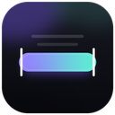
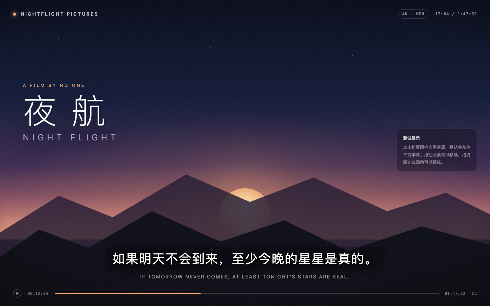
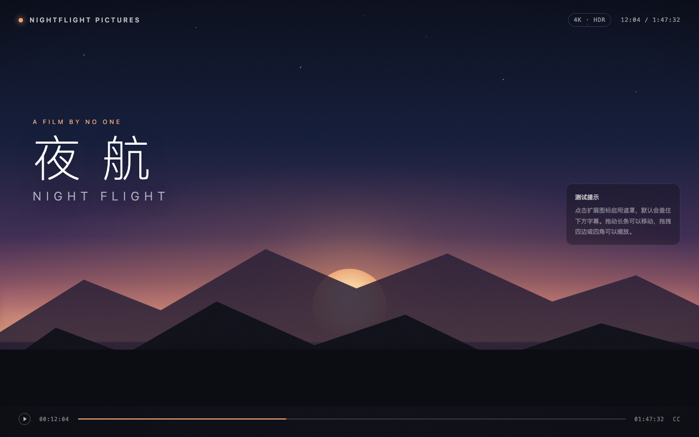
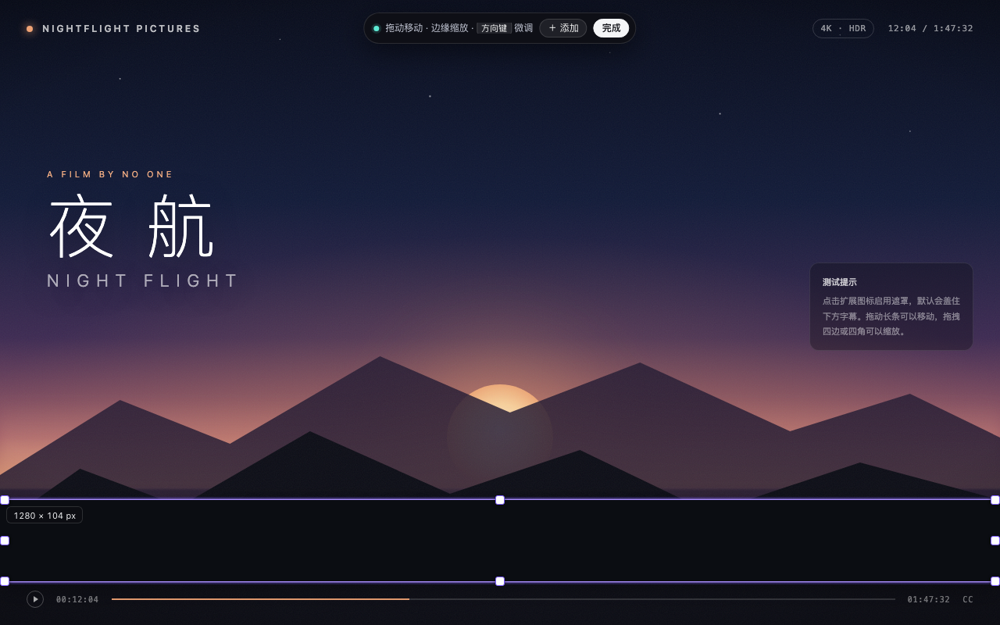
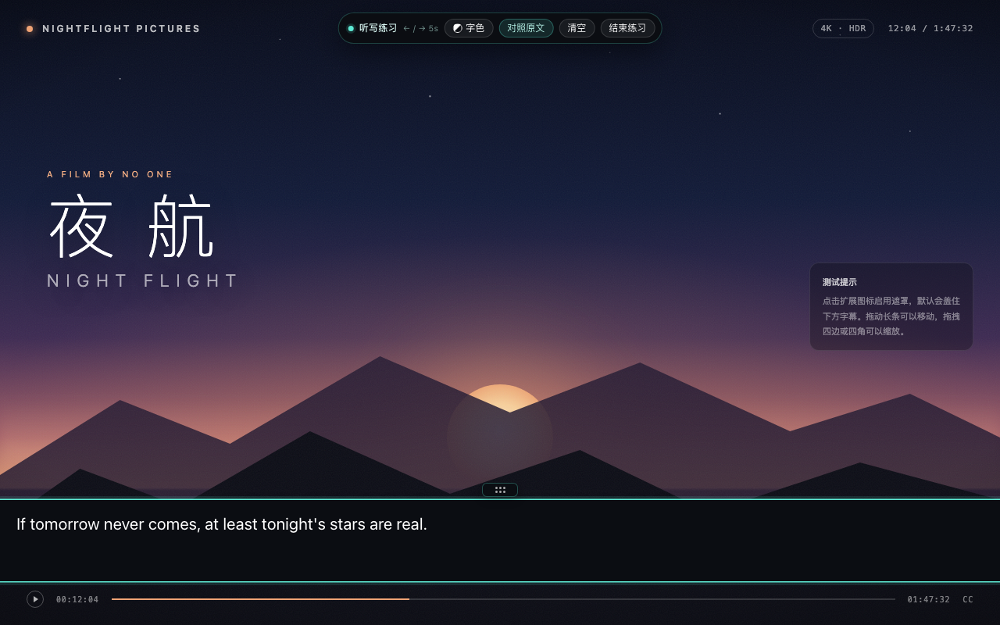
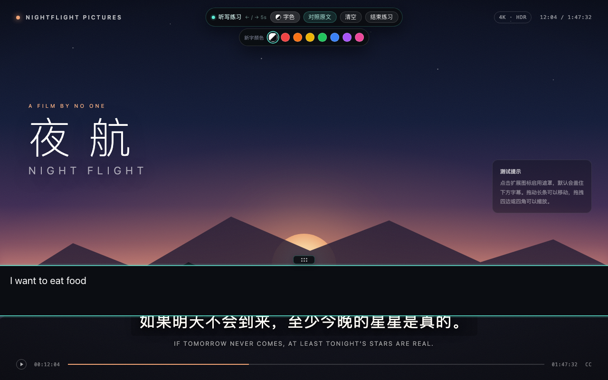
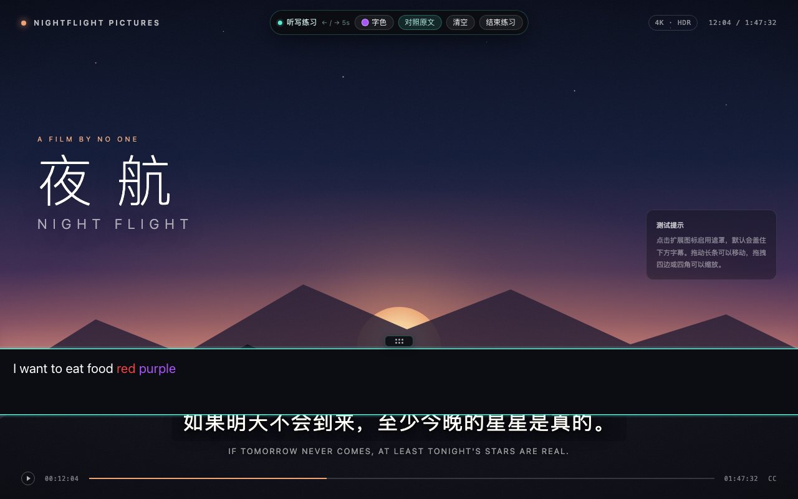
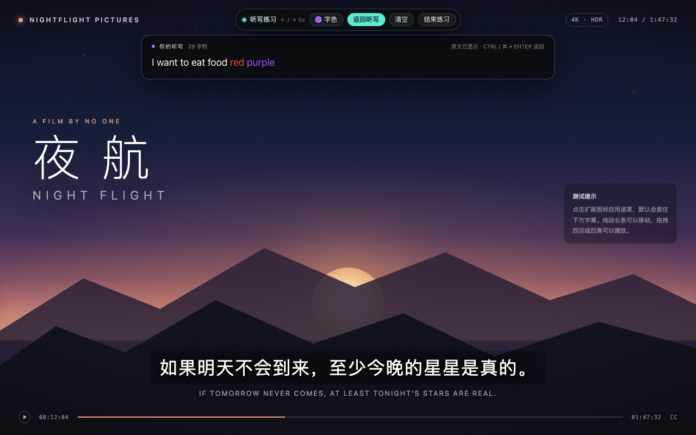
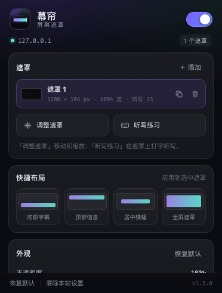

# 幕帘 · Screen Curtain

一个用于 Chrome / Edge 的轻量浏览器扩展：在任意网页上放一条**可拖动、可缩放、还能直接打字**的遮罩长条，用来挡住字幕、弹幕、台标，或者任何不想看到的画面。

它也可以当作**英语听力听写工具**：遮住原字幕，在遮罩上听一句写一句，再一键对照原文。



## 效果

<p align="center">
  
  
</p>

<p align="center">
  
</p>

<p align="center">
  
</p>

<p align="center">
  
</p>

<p align="center">
  
</p>

<p align="center">
  
</p>

<p align="center">
  
</p>

## 功能

- **可调节长条**：拖动遮罩移动，拖拽四边或四角缩放；编辑时实时显示像素尺寸。
- **多遮罩**：同一页面最多放 12 条遮罩，分别盖住字幕、台标、水印等区域。
- **外观可调**：不透明度、颜色、圆角、边缘羽化、毛玻璃模糊。
- **快捷布局**：底部字幕、顶部信息、居中横幅、全屏遮罩，一键套用。
- **按网站保存**：每个域名独立记忆位置、尺寸和外观，刷新或重启浏览器后自动恢复。
- **遮罩上听写**：听写练习模式下，遮罩变成输入框，可直接用键盘打字；关闭拼写检查与自动纠正，保留真实输入。
- **带字移动**：写完内容后，拖动遮罩上方的六点把手仍可移动整条遮罩；文字、光标和输入焦点都不会丢失。编辑模式下拖动带字遮罩同样不会丢字。
- **多色订正**：工具条「字色」提供自动、红、橙、黄、绿、蓝、紫、粉 8 种颜色。新输入使用当前字色，已有文字保持原色；选中一段文字后再点颜色，可以只给这一段改色。
- **一键对照**：点「对照原文」或按 `Cmd/Ctrl + Enter`，遮罩暂时隐藏露出字幕，你的听写内容（含颜色）会浮到上方卡片，逐句核对。
- **听写持久化**：每个遮罩的听写文字、颜色和当前字色随站点保存，刷新或重启浏览器后仍在；面板中显示已输入字符数。
- **方向键控制视频**：在听写框内按 `←` / `→` 直接让原视频回退 / 前进 5 秒，**不会移动输入光标**；按住方向键每次微调 1 秒，`Shift + 方向键` 仍用于选择文字。
- **不挡操作**：非编辑、非练习状态下遮罩不接收鼠标事件，页面照常点击、滚动、播放。
- **编辑模式**：只有进入编辑模式才会出现手柄和提示条；点「完成」或按 `Esc` 退出。
- **全屏可用**：全屏播放时遮罩会自动迁移到全屏元素内部（适用于容器式全屏播放器）。
- **快捷操作**：工具栏弹出面板、右键菜单、四组键盘快捷键。
- **严格 CSP 页面可用**：通过 Shadow DOM + 构造样式表注入，不依赖页面内联样式。
- **纯本地**：不发送网络请求，不上传任何数据。

## 安装（开发者模式）

1. 下载本目录，或克隆仓库。
2. 打开 Chrome 的 `chrome://extensions`（Edge 为 `edge://extensions`）。
3. 打开右上角的 **开发者模式**。
4. 点击 **加载已解压的扩展程序**，选择本目录（包含 `manifest.json` 的 `screen-curtain` 文件夹）。
5. 建议点击扩展图标旁的图钉，把「幕帘」固定到工具栏。

> 如果要在本地 `file://` 页面上使用，需要在扩展详情页额外开启「允许访问文件网址」。

## 使用

1. 打开任意视频网站或普通网页。
2. 点击工具栏中的「幕帘」图标，打开面板并启用遮罩；首次启用会自动进入编辑模式。
3. 拖动黑色长条调整位置，拖拽边缘/角落改变大小；也可以直接用方向键微调（按住 `Shift` 每次移动 10px）。
4. 点击页面顶部提示条上的 **完成**，或者按 `Esc`，退出编辑模式。
5. 之后遮罩只负责遮挡画面，不会影响页面的鼠标操作；再次点击图标可以调整外观或关闭遮罩。

在面板中还可以：

- 添加 / 复制 / 删除遮罩；
- 修改颜色与不透明度、圆角、羽化、毛玻璃；
- 应用「底部字幕」「顶部信息」「居中横幅」「全屏遮罩」预设；
- 用「恢复默认」重置位置和外观，或用「清除本站设置」删除该网站的全部数据。

## 英语听写练习

1. 先把遮罩拖到盖住字幕的位置并调整好大小，然后退出编辑模式。
2. 打开扩展面板，点击 **听写练习**（或按 `Alt/Option + Shift + P`）。面板会自动关闭，输入焦点落在遮罩上。
3. 听一句，直接在遮罩里打出来。可以按 `Enter` 换行；拼写检查和自动纠错已关闭。
4. 写满或需要重新定位时，直接拖动遮罩上方的 **六点把手**；即使遮罩里已经有文字，也能移动，光标和焦点不会跑掉。编辑模式下移动带字遮罩同样安全。
5. 需要做二次订正时，点工具条上的 **字色**，选红色、紫色等再继续输入：新字使用新颜色，之前写的内容保持原色。选中已有文字后再点颜色，可以只改选中的那一段。
6. 没听清时不用移动光标：直接按 `←` 让视频回退 5 秒，按 `→` 前进 5 秒；光标始终留在文字末尾 / 原来的位置。按住方向键可以每次 1 秒地连续微调；需要选中文字时使用 `Shift + ←/→`。
7. 点页面顶部工具条上的 **对照原文**，或按 `Cmd/Ctrl + Enter`。遮罩暂时隐藏，原字幕露出来，你的听写内容（含颜色）显示在上方卡片里，方便逐句核对。
8. 点 **返回听写** 继续修改；点 **清空**（需点两次确认）开始下一句；点 **结束练习** 或按 `Esc` 退出。

听写文字、每段文字的颜色以及当前选中的字色都会自动保存到当前网站，下次打开页面仍然保留。退出练习后，文字会以只读方式继续显示在遮罩上。

## 快捷键

| 功能 | macOS | Windows / Linux |
| --- | --- | --- |
| 显示 / 隐藏遮罩 | `⌥ ⇧ B` | `Alt + Shift + B` |
| 进入 / 退出编辑模式 | `⌥ ⇧ E` | `Alt + Shift + E` |
| 开始 / 结束听写练习 | `⌥ ⇧ P` | `Alt + Shift + P` |
| 添加一条遮罩 | `⌥ ⇧ A` | `Alt + Shift + A` |

编辑模式下额外支持：

| 操作 | 按键 |
| --- | --- |
| 微调位置 | 方向键（`Shift` 加速到 10px） |
| 删除选中遮罩 | `Delete` / `Backspace` |
| 复制选中遮罩 | `Cmd/Ctrl + D` |
| 退出编辑模式 | `Esc` |

听写练习中额外支持：

| 操作 | 按键 |
| --- | --- |
| 视频回退 / 前进 5 秒 | `←` / `→` |
| 连续微调（按住） | `←` / `→`，每次 1 秒 |
| 选择文字 | `Shift + ←/→` |
| 移动遮罩 | 拖动遮罩上方的六点把手 |
| 切换新字颜色 | 点击工具条「字色」 |
| 对照原文 / 返回听写 | `Cmd/Ctrl + Enter` |
| 退出练习 | `Esc` |

如果快捷键与其它扩展冲突，可在 `chrome://extensions/shortcuts` 中重新分配。

## 右键菜单

在页面空白处点击右键，可以直接：

- 显示 / 隐藏遮罩
- 调整遮罩位置
- 开始 / 结束听写练习
- 添加一条遮罩

## 权限说明

| 权限 | 用途 |
| --- | --- |
| `storage` | 把每个网站的位置、尺寸、外观和听写内容保存在本地 |
| `activeTab` / `scripting` | 在扩展安装前就已打开的标签页中按需注入脚本 |
| `contextMenus` | 提供右键菜单 |
| 网站访问权限 | 通过 content script 在网页中渲染遮罩 |

幕帘不包含任何统计、远程配置或网络请求。所有配置均保存在浏览器本地的 `chrome.storage.local` 中，不会同步或上传。

## 已知限制

- 浏览器内部页面（`chrome://...`、`edge://...`）和 Chrome 应用商店不允许扩展运行。
- 少数网站会直接对 `<video>` 元素做浏览器原生全屏，此时遮罩可能不可见；改用播放器容器的全屏按钮通常可以解决。
- 遮罩只注入顶层页面；iframe 内的内容在全屏时可能不受遮罩覆盖。
- 目前仅适配 Chromium 内核浏览器（Chrome、Edge 等），未适配 Firefox / Safari。
- 同一网站的不同页面共享一套遮罩配置。
- 听写内容跟着遮罩走；删除遮罩会同时删除它上面的文字。
- 方向键控制的是当前页面里最主要的 HTML5 `<video>` / `<audio>`。跨域 iframe 内嵌播放器、或完全用 canvas 绘制画面的播放器无法直接控制，此时方向键会退回为普通文字光标操作。

## 目录结构

```text
screen-curtain/
├── manifest.json          # MV3 清单
├── background.js          # service worker：右键菜单、快捷键分发
├── shared/
│   └── common.js          # 数据模型、默认值、存储读写
├── content/
│   └── content.js         # 遮罩渲染、拖动缩放、听写输入、对照、全屏迁移
├── popup/
│   ├── popup.html         # 弹出面板
│   ├── popup.css
│   └── popup.js
├── icons/                 # 16 / 32 / 48 / 128 图标
├── docs/                  # 截图
├── README.md
└── LICENSE
```

## 开发与测试

项目没有构建步骤，使用原生 HTML/CSS/JavaScript（Manifest V3）。修改代码后，在 `chrome://extensions` 中点击扩展卡片上的刷新按钮即可。

与本项目同一工作区的 `screen-curtain-dev/` 是一个独立于扩展的端到端测试环境（不随扩展安装包分发）：

```bash
# 终端 1：启动演示页面
cd screen-curtain-dev/test-site
python3 -m http.server 8123

# 终端 2：用 Chrome for Testing 加载扩展并跑测试
cd screen-curtain-dev
node e2e.cjs
```

测试覆盖启用/关闭、拖动、缩放、颜色/圆角/羽化/毛玻璃、多遮罩、预设、Esc 退出、刷新持久化、容器全屏迁移、严格 CSP 页面、听写输入与对照、左右键控制视频且不移动光标、带字拖动把手、编辑模式移动带字遮罩、多色输入与颜色持久化、清空、面板启动练习与焦点回归，以及数据清除。运行截图会写入 `screen-curtain-dev/shots/`。

## 许可

[MIT](LICENSE)
